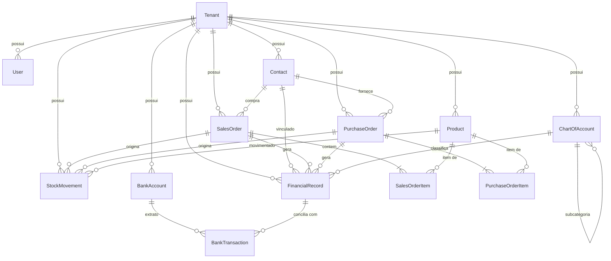

# Arquitetura Backend & Modelagem de Banco de Dados — ERP para PMEs

## Execução local

Requisitos: Node.js 20+, PostgreSQL e npm.

1. Copie `.env.example` para `.env` e informe `DATABASE_URL` e um `JWT_SECRET` aleatório com pelo menos 32 caracteres.
2. Instale as dependências na raiz e no frontend: `npm ci` e `npm ci --prefix frontend`.
3. Gere o Prisma Client e aplique as migrações: `npm run prisma:generate` e `npm run prisma:migrate`.
4. Inicialize o primeiro administrador pela linha de comando, nunca por cadastro público. Em banco novo, informe `BOOTSTRAP_TENANT_DOCUMENT`, `BOOTSTRAP_COMPANY_NAME`, `BOOTSTRAP_COMPANY_EMAIL`, `BOOTSTRAP_ADMIN_NAME`, `BOOTSTRAP_ADMIN_EMAIL` e `BOOTSTRAP_ADMIN_PASSWORD` (mínimo 12 caracteres), e rode `npm run admin:bootstrap`. Para empresa existente, informe `BOOTSTRAP_TENANT_ID` ou `BOOTSTRAP_TENANT_DOCUMENT` junto dos dados do administrador.
5. Inicie a API com `npm run start:dev` (o comando compila o backend antes de iniciar; em produção, use `npm start` após o build).
6. Em outro terminal, inicie a interface com `npm run dev --prefix frontend`.

A API fica em `http://localhost:3000/api/v1`; a interface usa essa URL por padrão. Para outro endereço, defina `VITE_API_URL` no ambiente do Vite. `CORS_ORIGINS` aceita origens separadas por vírgula e, por padrão, permite `http://localhost:5173`.

### Deploy na Vercel

O repositório está configurado para um único projeto Vercel na raiz: o build gera a interface estática e publica a API NestJS como função serverless em `/api/*`. A interface usa `/api/v1` no mesmo domínio por padrão. Faça o import do repositório na Vercel sem mudar o Root Directory e configure as variáveis abaixo em **Project Settings → Environment Variables**:

- `DATABASE_URL`: URL de um PostgreSQL acessível pela Vercel (use um banco gerenciado; não use `localhost`).
- `JWT_SECRET`: segredo aleatório com pelo menos 32 caracteres.
- `CORS_ORIGINS`: opcional para essa implantação no mesmo domínio; necessário se outros domínios chamarem a API, com as origens separadas por vírgula.

O comando `build:vercel` gera o Prisma Client, compila o backend e cria `frontend/dist`. Aplique as migrações no banco de produção com `npx prisma migrate deploy` antes de usar o app e inicialize o primeiro administrador pelo script de bootstrap em ambiente com acesso ao banco. Não configure `VITE_API_URL` para uma URL local na Vercel.

O login da interface já valida as credenciais na API. As telas operacionais ainda usam dados demonstrativos em memória (`frontend/src/services/api.ts`); essas alterações não são persistidas e devem ser substituídas por chamadas aos endpoints antes de usar o ERP com dados reais.

### Administração, centros e dados legados

- O endpoint público de cadastro foi removido. `POST /api/v1/auth/login` autentica; `GET /api/v1/auth/me` retorna perfil e centros autorizados.
- O primeiro administrador é marcado no banco por `is_primary_admin`, protegido por índice único parcial por empresa. A inicialização é feita pelo script local `npm run admin:bootstrap`, que aborta se já existir um administrador principal.
- `GET /api/v1/centers` lista os centros ativos acessíveis ao usuário. Operações de negócio exigem `X-Center-ID`; o servidor confere que o centro pertence à empresa, está ativo e está vinculado ao usuário.
- Apenas o administrador principal acessa `/api/v1/admin/users`, `/api/v1/admin/centers`, `/api/v1/admin/audit-logs` e `/api/v1/admin/unassigned-records`.
- Registros históricos recebem `center_id = NULL` na migration e não são atribuídos automaticamente. O principal pode associá-los explicitamente em `POST /api/v1/admin/unassigned-records/:entity/:id/assign` (`entity`: `salesOrder`, `purchaseOrder`, `stockMovement`, `financialRecord`, `bankAccount`, `bankTransaction`, `batch` ou `productStock`). O estoque legado de produto aparece como saldo pendente; atribuí-lo cria o saldo do centro escolhido sem alterar o total histórico do produto.
- Os papéis de operação são validados no backend. O perfil principal não pode ser promovido por API; usuários desativados e empresas inativas deixam de autenticar mesmo que tenham um JWT ainda válido.
- Execute `npm test` para compilar o backend e rodar os testes de acesso a centros e guardas administrativas.

Projeto arquitetural de um ERP modular, leve e de alta integridade transacional voltado para Pequenas e Médias Empresas (PMEs), estruturado em torno dos três fluxos operacionais vitais: **Vendas/Faturamento**, **Compras/Estoque** e **Gestão Financeira**.

---

## 1. Stack Tecnológica Selecionada & Justificativa

| Camada | Tecnologia | Justificativa Técnica |
| :--- | :--- | :--- |
| **Linguagem / Runtime** | **Node.js (TypeScript)** | Tipagem estática rigorosa para lidar com modelos fiscais, DTOs e entidades monetárias sem riscos de coerção de tipos. |
| **Framework Web** | **NestJS** | Padrão arquitetural corporativo pronto para produção (Injeção de Dependências, arquitetura modular, Guards, Interceptors, Pipes de validação nativos). |
| **Banco de Dados** | **PostgreSQL (v15+)** | Banco relacional robusto com garantias ACID estritas, suporte nativo a tipos numéricos de alta precisão (`DECIMAL(15, 4)`), tipos de chave UUID, e **Row-Level Security (RLS)**. |
| **ORM** | **Prisma ORM (v5+)** | Migrações declarativas, clientes tipados de alta performance e **Prisma Client Extensions** para injeção automática de filtros multi-tenant. |
| **Autenticação & Multi-tenancy** | **JWT + AsyncLocalStorage** | JWT validado contra usuário e empresa no banco em cada requisição; papel e centros autorizados são obtidos no servidor. |

---

## 2. Diagrama Entidade-Relacionamento (DER)



---

## 3. Estratégia de Isolamento de Dados (Multi-Tenancy)

Adota-se a arquitetura **Shared Database, Shared Schema com `tenant_id` obrigatório**, ideal para ERPs SaaS de PMEs por balancear custo operacional reduzido, alta densidade de tenants e facilidade de manutenção de migrações.

### Camadas de Segurança e Isolamento:

1. **Contexto de Execução Assíncrono (`AsyncLocalStorage`)**:
   - O middleware abre o contexto assíncrono; o guard JWT revalida usuário e empresa no banco e injeta `{ tenantId, userId, role, isPrimaryAdmin }`.
   - O guard de centro confere `X-Center-ID` e a associação ativa do usuário antes de permitir qualquer operação.

2. **Interceptação Transparente no ORM (`Prisma Client Extension`)**:
   - Todas as queries de leitura (`findMany`, `findFirst`, `count`) têm a cláusula `{ where: { tenantId } }` injetada automaticamente.
   - Todas as queries de escrita (`create`, `createMany`) recebem `{ data: { tenantId } }`.
   - Mutações únicas (`update`, `delete`, `findUnique`) são verificadas contra o tenant ativo antes de serem executadas.

3. **Performance e Integridade no Banco**:
   - Índices compostos `@@index([tenantId, ...])` e constraints de unicidade compostas (ex: `@@unique([tenantId, sku])`, `@@unique([tenantId, orderNumber])`) garantem index scans velozes e isolamento lógico.

4. **Defesa em Profundidade Opcional (PostgreSQL Row-Level Security)**:
   - Fornecido script SQL (`prisma/rls_defense_in_depth.sql`) aplicando políticas RLS nativas caso haja requisitos de auditoria rigorosa.

---

## 4. Detalhamento dos 3 Fluxos Críticos

### Fluxo A: Vendas & Faturamento
1. **Orçamento / Pedido**: Criação do pedido com status `DRAFT`.
2. **Aprovação**: Status `APPROVED`.
3. **Faturamento (`INVOICED`)**:
   - Valida saldo em estoque de todos os itens do pedido em transação atômica.
   - Decrementa `currentStock` no catálogo de produtos.
   - Registra movimentação de saída no `StockMovement` (tipo `OUT_SALE`), vinculando `salesOrderId`.
   - Gera o título financeiro no `FinancialRecord` (tipo `RECEIVABLE`, status `PENDING`), com cálculo de datas e parcelas.

### Fluxo B: Compras & Entrada de Mercadoria
1. **Cotação / Pedido**: Criação do pedido com status `DRAFT`.
2. **Importação de NF-e**: Suporte a chave de acesso com 44 dígitos (`invoiceKey`) e link de XML.
3. **Recebimento (`RECEIVED`)**:
   - Acrescenta as quantidades ao `currentStock`.
   - Recalcula o **Custo Médio Ponderado (CMP)** do produto.
   - Registra movimentação de entrada no `StockMovement` (tipo `IN_PURCHASE`).
   - Gera o título no `FinancialRecord` (tipo `PAYABLE`, status `PENDING`).

### Fluxo C: Gestão Financeira & Conciliação Bancária
1. **Plano de Contas**: Estrutura hierárquica para classificação contábil/gerencial (DRE).
2. **Contas a Pagar / Receber**: Controle de juros, multas, descontos e saldo devedor/a receber (`balanceAmount`).
3. **Baixa / Liquidação**:
   - Atualiza o título para `PAID` ou `PARTIALLY_PAID`.
   - Gera a transação bancária no extrato (`BankTransaction`: `CREDIT` ou `DEBIT`).
   - Atualiza o saldo em tempo real da conta bancária (`BankAccount.currentBalance`).
4. **Conciliação**: Vínculo entre lançamentos bancários (OFX/PIX) e títulos do ERP.

---

## 5. Endpoints REST da API

Todos os endpoints de negócio operam sob `/api/v1` e exigem `Authorization: Bearer <TOKEN>`. Operações de centro também exigem `X-Center-ID`; o servidor valida o vínculo antes de executar consultas ou gravações. Login é a única rota pública; a criação do primeiro administrador é um comando local de inicialização.

### 5.1 Autenticação (`/api/v1/auth`)
* `POST /auth/login`: Validação de credenciais com bcrypt e emissão de JWT. Usuário, papel e status são revalidados no banco em cada requisição.
* `GET /auth/me`: Perfil e centros ativos autorizados para a sessão.

### 5.2 Cadastros Base (`/contacts`, `/products`, `/categories`)
* `CRUD /contacts`: Cadastro unificado de Pessoas (Clientes, Fornecedores ou Ambos) com validação de CPF/CNPJ.
* `CRUD /products`: Catálogo de Produtos e Serviços, controle de SKU único por tenant, código de barras, NCM e geração automática de estoque inicial auditável.
* `CRUD /categories`: Plano de Contas hierárquico com subcategorias para classificação contábil (Receitas, Despesas, Ativos e Passivos).

### 5.3 Vendas & Faturamento (`/api/v1/sales`)
* `POST /sales`: Criação de venda. Se `approveNow: true` (padrão):
  1. Valida saldo em estoque de cada produto físico.
  2. Decrementa o estoque imediatamente.
  3. Registra saída auditável em `StockMovements` (`OUT_SALE`).
  4. Gera títulos no `FinancialRecords` (Contas a Receber) desdobrados no número de parcelas desejado.
* `POST /sales/:id/invoice`: Faturamento avulso de um orçamento que estava em rascunho (`DRAFT`).
* `GET /sales`: Listagem de vendas com filtros por status (`DRAFT`, `APPROVED`, `INVOICED`, `CANCELLED`).
* `GET /sales/:id`: Detalhes completos da venda com itens, parcelas financeiras e histórico de estoque.

### 5.4 Compras & Entrada de Mercadoria (`/api/v1/purchases`)
* `POST /purchases`: Registro de compra. Se `receiveNow: true` (padrão):
  1. Dá entrada no estoque dos produtos.
  2. Recalcula o **Custo Médio Ponderado (CMP)** do produto.
  3. Registra entrada auditável em `StockMovements` (`IN_PURCHASE`).
  4. Gera títulos no `FinancialRecords` (Contas a Pagar).
* `POST /purchases/:id/receive`: Entrada de mercadoria de uma cotação/compra pendente.
* `GET /purchases`: Listagem de compras com filtro por status.
* `GET /purchases/:id`: Detalhamento completo da compra.

### 5.5 Gestão Financeira & Conciliação (`/api/v1/financial`)
* `GET /financial/cash-flow`: Fluxo de Caixa Consolidado e Projetado:
  - Saldo real somado de todas as contas bancárias e caixas ativos.
  - Receitas e Despesas realizadas no período.
  - Recebimentos e Pagamentos projetados futuros.
  - Saldo final projetado.
  - Linha do tempo dia a dia (`dailyTimeline`) com saldo acumulativo.
* `POST /financial/reconcile`: Conciliação Bancária:
  - Vincula uma transação de extrato (`BankTransaction`) a um título (`FinancialRecord`).
  - Abate o saldo do título e altera o status para `PAID` ou `PARTIALLY_PAID`.
  - Atualiza o saldo da conta bancária (`BankAccount`).
* `POST /financial/records/:id/settle`: Baixa manual de título com aplicação de juros, multas, descontos e lançamento no extrato bancário.
* `POST /financial/records`: Criação de título avulso a pagar/receber (ex: aluguel, energia, tributos).
* `GET /financial/records`: Listagem com filtros por tipo, status, período e contato.

### 5.6 Contas Bancárias & Extratos (`/api/v1/banking`)
* `POST /banking/accounts`: Criação de conta corrente ou caixa físico.
* `GET /banking/accounts`: Listagem de contas com saldos em tempo real.
* `POST /banking/transactions`: Lançamento avulso de extrato bancário (PIX, OFX, TED).
* `GET /banking/accounts/:id/transactions`: Extrato da conta com filtro de conciliação.

---

## 6. Estrutura Completa de Arquivos do Backend

```text
├── prisma/
│   ├── schema.prisma                  # Modelagem relacional completa das 9 entidades
│   └── rls_defense_in_depth.sql       # Script de Row-Level Security PostgreSQL
├── src/
│   ├── common/
│   │   ├── database/
│   │   │   └── prisma.service.ts      # Cliente estendido com regras multi-tenant
│   │   ├── enums/
│   │   │   └── domain.enums.ts        # Enums de Vendas, Compras, Estoque e Financeiro
│   │   ├── guards/
│   │   │   └── jwt-auth.guard.ts      # Guard JWT com injeção de TenantContext
│   │   └── multitenancy/
│   │       ├── prisma-tenant.extension.ts  # Interceptor automático de consultas
│   │       ├── tenant-context.service.ts   # AsyncLocalStorage de sessão
│   │       └── tenant.middleware.ts        # Middleware de captura do Tenant
│   ├── modules/
│   │   ├── auth/                      # Login e sessão; sem cadastro público
│   │   ├── admin/                     # Gestão protegida de usuários, centros e auditoria
│   │   │   ├── dto/
│   │   │   ├── strategies/
│   │   │   ├── auth.controller.ts
│   │   │   ├── auth.service.ts
│   │   │   └── auth.module.ts
│   │   ├── contacts/                  # CRUD /contacts
│   │   ├── products/                  # CRUD /products
│   │   ├── categories/                # CRUD /categories (Plano de Contas)
│   │   ├── sales/                     # POST /sales (Automação Estoque + Receber)
│   │   ├── purchases/                 # POST /purchases (Automação Estoque + Pagar)
│   │   ├── financial/                 # GET /cash-flow, POST /reconcile, /settle
│   │   ├── banking/                   # /banking/accounts e /transactions
│   │   └── stock/                     # Ajustes manuais e auditoria
│   ├── app.module.ts                  # Registro dos módulos e middleware global
│   └── main.ts                        # Bootstrap NestJS com ValidationPipe global
├── package.json
└── tsconfig.json
```

